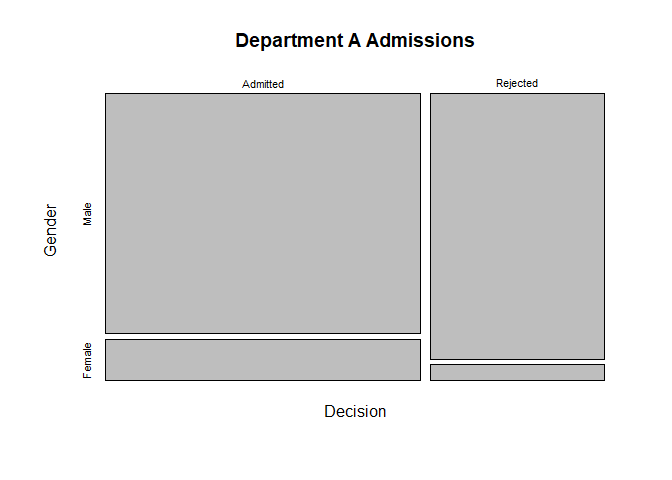

Exploring R’s Object Oriented Systems
================

### Choose or Download Data

``` r
data("UCBAdmissions")
head(UCBAdmissions)
```

    ## , , Dept = A
    ## 
    ##           Gender
    ## Admit      Male Female
    ##   Admitted  512     89
    ##   Rejected  313     19
    ## 
    ## , , Dept = B
    ## 
    ##           Gender
    ## Admit      Male Female
    ##   Admitted  353     17
    ##   Rejected  207      8
    ## 
    ## , , Dept = C
    ## 
    ##           Gender
    ## Admit      Male Female
    ##   Admitted  120    202
    ##   Rejected  205    391
    ## 
    ## , , Dept = D
    ## 
    ##           Gender
    ## Admit      Male Female
    ##   Admitted  138    131
    ##   Rejected  279    244
    ## 
    ## , , Dept = E
    ## 
    ##           Gender
    ## Admit      Male Female
    ##   Admitted   53     94
    ##   Rejected  138    299
    ## 
    ## , , Dept = F
    ## 
    ##           Gender
    ## Admit      Male Female
    ##   Admitted   22     24
    ##   Rejected  351    317

``` r
str(UCBAdmissions)
```

    ##  'table' num [1:2, 1:2, 1:6] 512 313 89 19 353 207 17 8 120 205 ...
    ##  - attr(*, "dimnames")=List of 3
    ##   ..$ Admit : chr [1:2] "Admitted" "Rejected"
    ##   ..$ Gender: chr [1:2] "Male" "Female"
    ##   ..$ Dept  : chr [1:6] "A" "B" "C" "D" ...

### Test Generic Functions

``` r
print(UCBAdmissions)
```

    ## , , Dept = A
    ## 
    ##           Gender
    ## Admit      Male Female
    ##   Admitted  512     89
    ##   Rejected  313     19
    ## 
    ## , , Dept = B
    ## 
    ##           Gender
    ## Admit      Male Female
    ##   Admitted  353     17
    ##   Rejected  207      8
    ## 
    ## , , Dept = C
    ## 
    ##           Gender
    ## Admit      Male Female
    ##   Admitted  120    202
    ##   Rejected  205    391
    ## 
    ## , , Dept = D
    ## 
    ##           Gender
    ## Admit      Male Female
    ##   Admitted  138    131
    ##   Rejected  279    244
    ## 
    ## , , Dept = E
    ## 
    ##           Gender
    ## Admit      Male Female
    ##   Admitted   53     94
    ##   Rejected  138    299
    ## 
    ## , , Dept = F
    ## 
    ##           Gender
    ## Admit      Male Female
    ##   Admitted   22     24
    ##   Rejected  351    317

``` r
summary(UCBAdmissions)
```

    ## Number of cases in table: 4526 
    ## Number of factors: 3 
    ## Test for independence of all factors:
    ##  Chisq = 2000.3, df = 16, p-value = 0

``` r
plot(UCBAdmissions[,,1],
     main = "Department A Admissions",
     xlab = "Decision")
```

<!-- -->

### Explore S3 vs. S4

``` r
s3_obj <- list(name = "Myself", age = 29, GPA = 3.5)
class(s3_obj) <- "student_s3"

setClass("student_s4",
         slots = c(name = "character", age = "numeric", GPA = "numeric"))
s4_obj <- new("student_s4", name = "Myself", age = 29, GPA = 3.5)

print(s3_obj)
```

    ## $name
    ## [1] "Myself"
    ## 
    ## $age
    ## [1] 29
    ## 
    ## $GPA
    ## [1] 3.5
    ## 
    ## attr(,"class")
    ## [1] "student_s3"

``` r
print(s4_obj)
```

    ## An object of class "student_s4"
    ## Slot "name":
    ## [1] "Myself"
    ## 
    ## Slot "age":
    ## [1] 29
    ## 
    ## Slot "GPA":
    ## [1] 3.5
